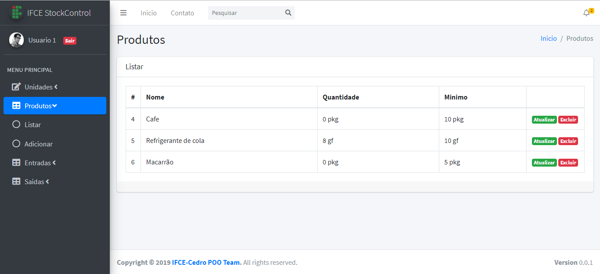

# StockControl IFCE Cedro

Este é um sistema para controle de estoque desenvolvido usando Java com Hibernate e Web API. No processo de desenvolvimento utilizou-se a IDE Eclipse e gerenciador de pacotes Maven.

Foi utilizado o banco de banco MySQL disponível da suíte XAMPP utilizando o ambiente Windows 10.

## Ferramentas de Desenvolvimento

- Eclipse 2019-09
- XAMPP (Apache e MySQL)
- Visual Code
- GIMP

## Bibliotecas utilizadas

- Hibernate
- Java EE Web API
- MySQL Connector

## Ambiente Linux

O sistema também funciona para ambientes linux teste que configurados adequadamente.

## Docker

```bash
docker compose up --build
```

A aplicação fica disponível em <http://localhost:8080> e o banco sobe junto, já com
dados fictícios de exemplo (unidades, produtos, entradas e saídas).

- O povoamento acontece apenas quando o banco está vazio, então reiniciar o container
  não duplica os dados. Para recomeçar do zero, é preciso apagar o volume:

  ```bash
  docker compose down -v && docker compose up --build
  ```

- Para iniciar com o banco em branco, defina `APP_SEED: "false"` no serviço `app`
  do `docker-compose.yml`.

- O MySQL sobe com `utf8mb4` para os acentos não se corromperem. Tabelas criadas por
  versões anteriores ficaram em `latin1` e só são corrigidas recriando o volume com
  `docker compose down -v`.

## Regras de exclusão

- **Unidade** em uso por algum produto não pode ser excluída.
- **Produto** com movimentações de estoque (entradas ou saídas) não pode ser excluído.

Nas duas situações a exclusão é recusada e a tela informa o motivo, em vez de deixar
uma referência órfã que quebraria as demais telas.

## Equipe

- Fabrício
- Felipe Gabriel B. de Souza
- Francisco de A. Silva
- José Ailton B. da Silva
- Issac Santos
- Raimundo Kennedy Costa

# Tela

