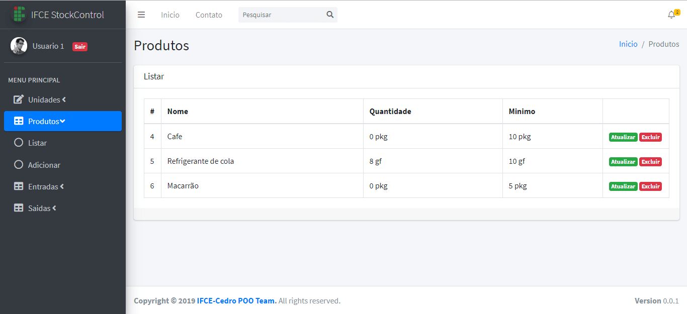

[English](README.md) | [Português](README.pt-BR.md)

# StockControl IFCE Cedro


An inventory/stock control system built with **Java 25**, **Jakarta EE 11** (Servlet/JSP), and **Hibernate ORM 7** (native API, programmatic configuration). The application is packaged as a WAR with Maven and can be run with Docker.

## Features

- **Units, products, entries, and exits** management (CRUD flows for inventory control).
- **Bilingual UI (Portuguese and English):** a language selector on the login screen switches the interface language. The selected language is stored in the session after login and applied across all screens.
- **Authentication** with session-based login.
- **Deletion safeguards:** items referenced by other records cannot be removed (see [Deletion rules](#deletion-rules)).
- **Optional seed data:** the database can be populated with sample data when empty.

## Tech stack

- **Java:** 25
- **Web:** Jakarta Servlet/JSP, JSTL (Jakarta Tags), AdminLTE-based UI
- **Persistence:** Hibernate ORM 7 (native API), MySQL
- **Build/Run:** Maven (WAR), Apache Tomcat 11 (Cargo plugin for local runs), Docker Compose
- **Libraries:** Lombok, jBCrypt, MySQL Connector/J

## Running with Docker

```bash
docker compose up --build
```

- The application is available at <http://localhost:8080>.
- The MySQL database starts alongside the app (MySQL 5.7 in the provided `docker-compose.yml`, configured with `utf8mb4`).
- By default, sample data (units, products, entries, and exits) is seeded **only when the database is empty**, so restarting containers does not duplicate data.

### Resetting the database

To start from a clean database (removes the persisted volume):

```bash
docker compose down -v && docker compose up --build
```

### Starting with an empty database

Set `APP_SEED: "false"` for the `app` service in `docker-compose.yml`.

### Charset note

MySQL is started with `utf8mb4` to avoid corrupted accented characters. Tables created by older versions may have been created with `latin1` and are only fully corrected by recreating the volume (`docker compose down -v`).

## Local development (without Docker)

Requirements: Java 25, Maven, and a reachable MySQL instance.

Database connection settings are read from environment variables in `src/main/java/br/edu/ifce/cedro/stockcontrol/util/HibernateUtil.java` (with defaults such as `jdbc:mysql://db:3306/stockcontrol-ifce`, user `root`). Configure `HIBERNATE_CONNECTION_URL`, `HIBERNATE_CONNECTION_USERNAME`, `HIBERNATE_CONNECTION_PASSWORD`, etc., as needed.

Run with the Cargo/Tomcat plugin:

```bash
mvn cargo:run
```

## Deletion rules

- A **unit** that is used by any product cannot be deleted.
- A **product** that has stock movements (entries or exits) cannot be deleted.

In both cases, the deletion is rejected and the UI shows the reason, preventing orphan references.

## Team

- Fabrício
- Felipe Gabriel B. de Souza
- Francisco de A. Silva
- José Ailton B. da Silva
- Issac Santos
- Raimundo Kennedy Costa

## Screenshot


