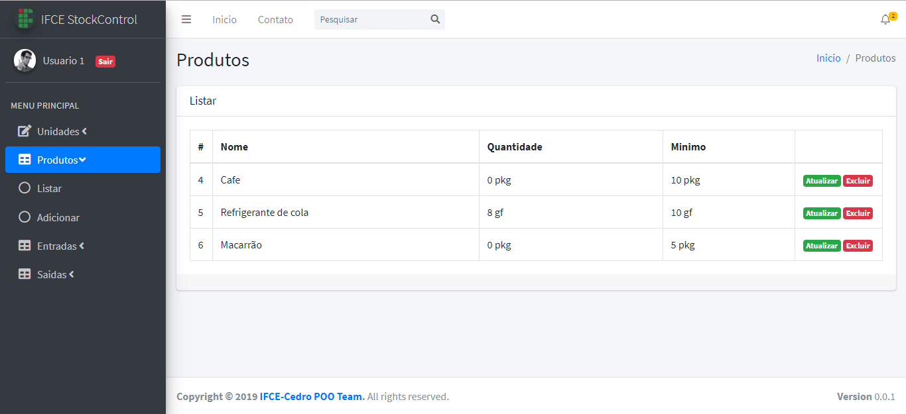

[English](README.md) | [Português](README.pt-BR.md)

# StockControl IFCE Cedro


Sistema para controle de estoque desenvolvido com **Java 25**, **Jakarta EE 11** (Servlet/JSP) e **Hibernate 7** (API nativa, configuração programática), empacotado com Maven e executável via Docker.

## Idiomas

A aplicação possui interface em **Português (padrão)** e **Inglês**. Na tela de login há um seletor de idioma; a escolha é mantida na sessão após o login e aplicada em todas as telas.

## Ferramentas de desenvolvimento

- Java 25
- Eclipse IDE
- XAMPP (Apache e MySQL)
- Visual Studio Code
- GIMP

## Bibliotecas utilizadas

- Hibernate ORM
- Jakarta EE Web API / JSTL
- MySQL Connector/J
- Lombok
- jBCrypt

## Docker

```bash
docker compose up --build
```

A aplicação fica disponível em <http://localhost:8080> e o banco sobe junto, já com dados fictícios de exemplo (unidades, produtos, entradas e saídas).

- O povoamento acontece apenas quando o banco está vazio, então reiniciar o container não duplica os dados. Para recomeçar do zero, é preciso apagar o volume:

  ```bash
  docker compose down -v && docker compose up --build
  ```

- Para iniciar com o banco em branco, defina `APP_SEED: "false"` no serviço `app` do `docker-compose.yml`.

- O MySQL sobe com `utf8mb4` para os acentos não se corromperem. Tabelas criadas por versões anteriores ficaram em `latin1` e só são corrigidas recriando o volume com `docker compose down -v`.

## Regras de exclusão

- **Unidade** em uso por algum produto não pode ser excluída.
- **Produto** com movimentações de estoque (entradas ou saídas) não pode ser excluído.

Nas duas situações a exclusão é recusada e a tela informa o motivo, em vez de deixar uma referência órfã que quebraria as demais telas.

## Equipe

- Fabrício
- Felipe Gabriel B. de Souza
- Francisco de A. Silva
- José Ailton B. da Silva
- Issac Santos
- Raimundo Kennedy Costa

## Tela


